<a href="https://irreplaceable-gamma.vercel.app">
  <picture>
    <source media="(max-width: 640px)" srcset="docs/banner-narrow.svg">
    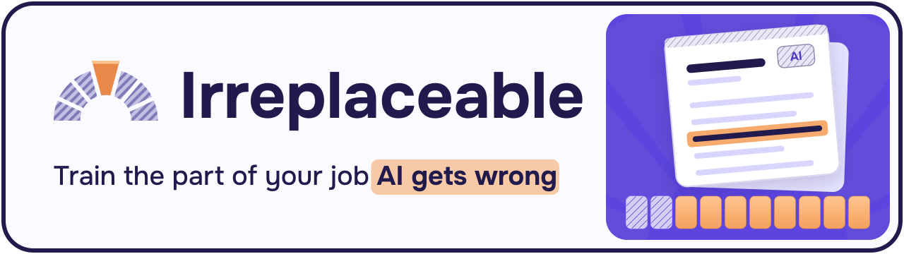
  </picture>
</a>

<p align="center">
  <a href="https://irreplaceable-gamma.vercel.app"></a>
  
  
  
  
  
  
</p>

**Irreplaceable takes your job apart task by task, shows from real usage data which of those tasks AI already does, and gives you ten-minute daily reps built from your own work, so you stay the person who can't be replaced.**

**Live product:** [irreplaceable-gamma.vercel.app](https://irreplaceable-gamma.vercel.app)<br>
**Jury, one click:** [irreplaceable-gamma.vercel.app/cup](https://irreplaceable-gamma.vercel.app/cup), then press **As a nurse**, **As a software engineer** or **As an accountant**<br>
**Team:** Darina Berentayeva, solo

### In 30 seconds

- **Who it is for:** working Americans aged 25 to 45 whose week is partly documents, information, conversations or decisions, in any field, not only IT.
- **The pain:** they hear that AI is taking jobs, but nobody shows them which parts of *their* week it already does, or what to do about it on Monday.
- **What it does:** a free week map built from public data, then daily reps on their own tasks (catch an AI's mistakes, brief an AI, handle the human part), a 12-week plan, proof for the next review and a personal AI coach.
- **Plans:** Free, Pro at $19 a month or $119 a year, Max at $79 a month or $479 a year. Max is free until November 30, 2026 through the Business Cup 2.0 offer.
- **Business:** 27.3M workers aged 25 to 44 are in occupations where AI does or speeds up at least a third of the week. $100M ARR needs 679K payers. LTV $116 against a blended CAC of $32 gives LTV/CAC 3.6, from public benchmarks with assumptions marked.
- **Tech:** Next.js 16, Upstash Redis, OpenRouter with Gemini 3.8 Flash and GPT-6 Luna failing over to each other, Stripe in test mode, scrypt accounts. Numbers on the map come from code, never from the model.

<p>
  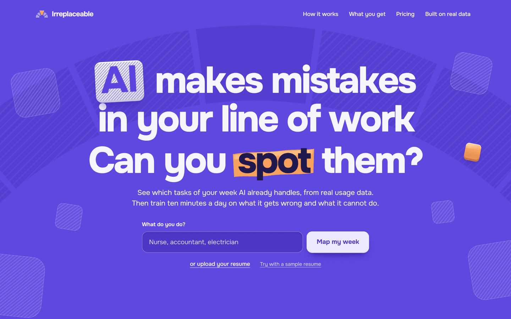
  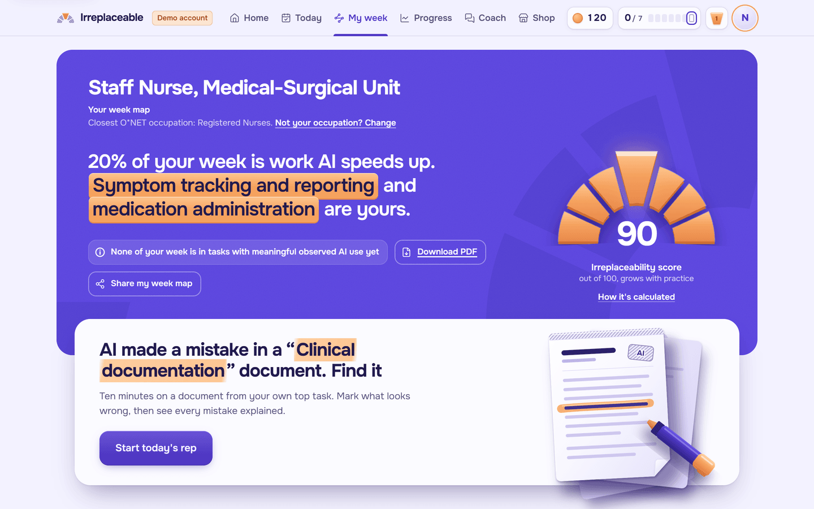
</p>
<sub>Left: the landing page. Right: the top of a nurse's week map. All screenshots are from the running product.</sub>

<p align="center">
  <a href="#try-it-in-one-click">Try it</a> &nbsp;|&nbsp;
  <a href="#the-problem">Problem</a> &nbsp;|&nbsp;
  <a href="#how-it-works">How it works</a> &nbsp;|&nbsp;
  <a href="#what-you-get">What you get</a> &nbsp;|&nbsp;
  <a href="#plans">Plans</a> &nbsp;|&nbsp;
  <a href="#what-you-cant-get-by-asking-chatgpt">Beyond ChatGPT</a> &nbsp;|&nbsp;
  <a href="#the-business">Business</a> &nbsp;|&nbsp;
  <a href="#roadmap">Roadmap</a> &nbsp;|&nbsp;
  <a href="#data-and-method">Data</a> &nbsp;|&nbsp;
  <a href="#how-it-is-built">Architecture</a> &nbsp;|&nbsp;
  <a href="#run-it-locally">Run locally</a> &nbsp;|&nbsp;
  <a href="#honest-limits">Limits</a>
</p>

## Try it in one click

The jury buttons open a ready account with the top plan on, so every screen can be tried in a few minutes.

1. Open [irreplaceable-gamma.vercel.app/cup](https://irreplaceable-gamma.vercel.app/cup) and press **As a nurse**, **As a software engineer** or **As an accountant**.
2. You are signed into a shared demo account with Max on. Its week was built from a fictional sample resume by the same live pipeline every user goes through: the model read the resume, picked the occupation and proposed how the week splits, and code computed everything else.
3. The first click for each persona builds the account and takes about 20 seconds; later clicks open it at once. Each device gets its own coach chat inside the shared account.
4. To try your own job, log out and type your job title on the home page.

Everyone else gets the same offer on that page: **Max is free until November 30, 2026**, after a quick sign-up and with no card. The regular checkout also works in Stripe test mode with the card `4242 4242 4242 4242`.

| Where | What to do | What you see |
|---|---|---|
| Week map, **Tasks** tab | Change the hours of one task | The split, the score and the pay at stake recalculate at once in the browser, with no model call |
| **Today**, Spot the slip | Highlight the words you think are wrong and submit | Code grades your highlights against the planted mistakes and explains each one |
| **Today**, Delegate | Write a deliberately vague instruction | The review shows which traps in the material you missed |
| **Coach** | Ask about your week by text or with a voice message | An answer built from your own map, reps and plan |
| **Shop** | Redeem 250 points | A real Stripe discount code |

## The problem

Working people hear every week that AI is taking jobs, and nobody shows them which parts of their own week it already does.

**Who it is for.** Working Americans aged 25 to 45 with a job, a family and bills, in any field where part of the work is documents, information, conversations or decisions: nurses, accountants, paralegals, teachers, HR, sales, customer support, dispatchers, insurance, office managers, engineers and IT. It also covers trades where AI is changing the paperwork side of the job, such as estimates, reports and code compliance for electricians and technicians. These people already have experience and a job, and what they want is to stay valuable in it.

**When the question comes up.** A layoff headline, a colleague replaced by an assistant, a manager asking the team to "use AI", the yearly review, or simply asking yourself what you will be doing in three years.

| Number | What it means | Source |
|---|---|---|
| **52%** | US workers worried about how AI will be used at work; 32% expect fewer job opportunities for themselves | [Pew Research Center, February 2025](https://www.pewresearch.org/social-trends/2025/02/25/u-s-workers-are-more-worried-than-hopeful-about-future-ai-use-in-the-workplace/), 5,273 workers |
| **28%** | Already use AI at work a few times a week or more | [Gallup, February 2026](https://www.gallup.com/workplace/704225/rising-ai-adoption-spurs-workforce-changes.aspx), 23,717 respondents |
| **27.3M** | Workers aged 25 to 44 in occupations where AI already does or speeds up at least a third of a typical week | Our pipeline, [method below](#data-and-method) |
| **$744B** | Their yearly pay that sits on those hours, counting sped-up hours at half | Our pipeline |
| **6.2% + 24.4%** | Share of all US work hours AI already does, plus the share it speeds up | Our pipeline |

**What people use today, and where it stops.**

| What exists | What it gives | Where it stops |
|---|---|---|
| AI risk calculators | One percentage for a whole job title, often the model's own guess | Two nurses with the same title do different work, and there is no next step |
| AI tool courses | How to use ChatGPT, Claude and Copilot, the same lesson for everyone | Your own tasks never come up, so nothing changes at work |
| Career apps | Job search and resumes | They assume you are leaving; they do nothing for the job you have |
| Asking ChatGPT | Any answer you think to ask for | No path, no memory of your progress, no proof you can show anyone |

The hard part is concrete: knowing which parts of your own week AI already does, changing how you work without dropping the work, proving your value to your manager, and knowing where to move if your role shrinks. Irreplaceable is built around exactly those four jobs.

## How it works

You bring your job; the product turns it into a week map, a plan and daily practice that leaves proof behind.

<p align="center">
  
</p>
<sub>Job title or resume, then the week map, then the 12-week plan, then daily reps, then proof. Free covers the first two steps; Pro the rest; Max adds the coach, Playbook, Second look and the Review kit.</sub>

## What you get

Everything starts from one object, **your own week**, split into the tasks it is made of.

| Feature | What it does for you | Plan |
|---|---|---|
| [Week map](#your-week-map) | Every task of your week sorted into AI already does it, AI speeds it up, stays yours, with evidence and a PDF report | Free |
| [AI or me?](#ai-or-me) | A one-minute daily game about your own tasks | Free |
| [Daily reps](#daily-reps-from-your-own-tasks) | Spot the slip, Delegate and Human edge, written live from your tasks and graded at once | One trial free, then Pro |
| [12-week plan](#a-12-week-plan-you-check-off) | Three to five checkable actions a week, built from your map and skills | Pro |
| [Skills from your resume](#skills-from-your-resume) | Your skills with quotes from your own text, and the gaps worth closing | Pro |
| [Next jobs](#next-jobs) | Nearby jobs where more of the week stays human, with pay and missing skills | Pro |
| [Proof](#proof-and-the-review-kit) | Every finished rep, dated and scored, on a shareable proof page | Pro |
| [Points, shop, streak and levels](#points-and-the-shop) | Points that become Stripe discounts and free months; XP, levels and a weekly leaderboard | Pro |
| [AI coach](#a-personal-ai-coach-with-voice) | Chat and voice messages with a coach that reads your whole record | Max |
| [Playbook](#playbook-second-look-and-job-pages) | Checked instructions for the tasks AI already helps with | Max |
| [Second look](#playbook-second-look-and-job-pages) | Paste an AI draft from work and see what to check before using it | Max |
| [Review kit](#proof-and-the-review-kit) | A one-page brief for the talk with your manager | Max |

### Your week map

The free week map shows your 40-hour week as tasks, each with the reason it sits in its group.

- **Input:** type a job title (the search covers 53,323 job titles from O\*NET) or drop a resume. A PDF resume is read in your browser, only its text goes to the server, and the text is never stored. The map takes about two minutes.
- **Three groups:** **AI already does it** (people already hand this task to AI at work, mostly to have it done for them), **AI speeds it up** (AI helps with it, or research rates it as something AI can do with the right tools) and **Stays yours** (hands-on work, work with people and judgment that AI does not reach yet).
- **Evidence on every task:** whether its group comes from observed AI use at work or from a research estimate, with the source one click away.
- **Overview tab:** your irreplaceability score from 0 to 100, your pay at stake, the three tasks to hand to AI first and your human edge.
- **Tasks tab:** change the hours of any task and every number recalculates instantly in the browser.
- **Free includes** the whole Overview and Tasks tabs and a print-ready PDF report of the week, with a preview of the other tabs. Pro opens the **Plan**, **Skills** and **Next jobs** tabs in full.

<p>
  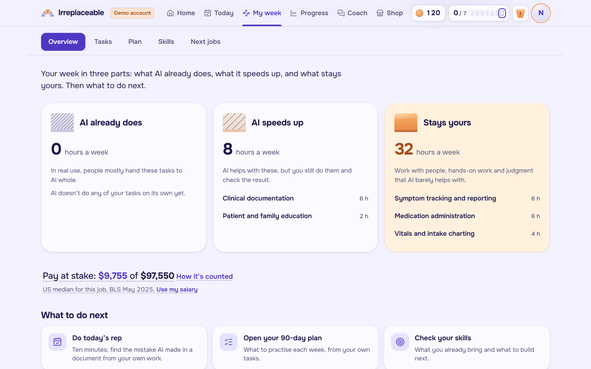
</p>
<sub>The Overview tab: hours per group, pay at stake from the BLS median, and the next three steps.</sub>

### Daily reps from your own tasks

A rep takes about ten minutes, is written live by the model from one task of your week, passes code checks and an independent second review before you see it, and is graded the moment you finish.

| Rep | What you do | How it is graded |
|---|---|---|
| **Spot the slip** | An AI drafted a document from one of your tasks (a patient discharge note, an invoice reconciliation, a dispatch route, a quiz for a class, a case memo, an electrician's estimate) and slipped in two to four mistakes of different kinds: a wrong fact, a calculation, broken logic, a compliance problem, a missing step or the wrong tone. You highlight the words you think are wrong. | Code compares your highlights with the known positions of the mistakes. The first stray highlight is free and each further one takes 15% off. Then every mistake is explained, with how the line should read. |
| **Delegate** | You get a real task from your week and its material, which hides a few traps. You write the instruction for AI, the model carries it out, and you review and fix what comes back. | A rubric graded by the model, plus code that checks which traps your instruction or your review caught. A trap that only the AI itself pointed out earns no credit. You also see what a strong instruction would have looked like. |
| **Human edge** | A conversation from the human part of your job: a worried patient, an upset client, a parent, a contractor who missed a deadline. The model plays the other person; you get up to six replies. | Graded against a rubric for the situation. A reply that could hurt someone is flagged and explained. |

You pick today's rep on the **Today** screen. One a day counts toward your streak, and you can do extra practice reps after it. The free plan includes one live Spot the slip on a task from your week.

<p>
  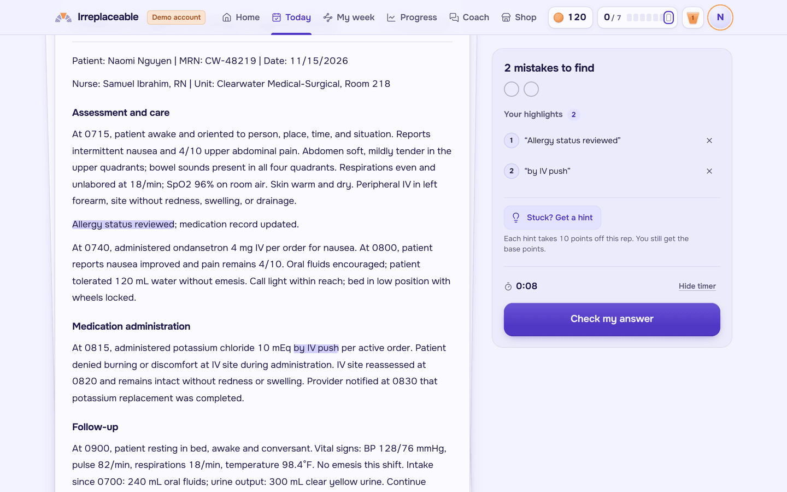
  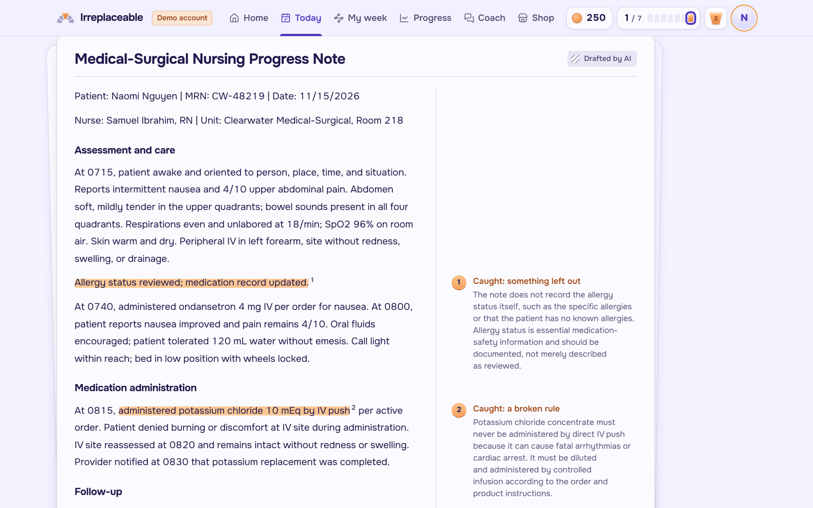
</p>
<sub>Spot the slip on a nurse's progress note. Left: two places highlighted. Right: both mistakes caught, with the reason each one matters.</sub>

<p>
  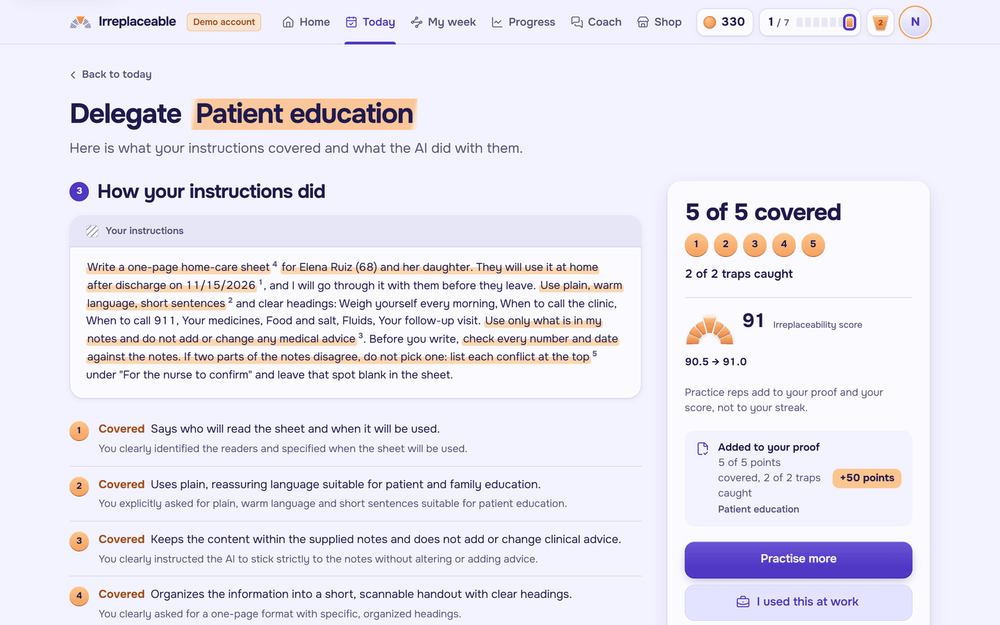
</p>
<sub>A Delegate rep: five of five rubric points covered and both traps in the material caught (two different sodium limits and two different appointment dates).</sub>

### AI or me?

Five tasks from your job in about a minute: for each one you guess whether people already use AI for it at work. The answers come from the same task data as your map, with no model involved, and the round can be played every day on any plan.

### A 12-week plan you check off

The model writes twelve weeks from your map, your skills and your gaps: first what to hand to AI, then how to check its work, then the part that stays yours.

- Each week has a focus and three to five concrete actions: a rep on a named task of your week, a skill to build, using a Playbook instruction at work on a named task, or a Review kit milestone.
- Code checks every item against your real tasks and skills before the plan is saved.
- Every checked item earns XP and points, the plan downloads as a clean PDF, and when your week or skills change the plan tells you it is out of date.

<p>
  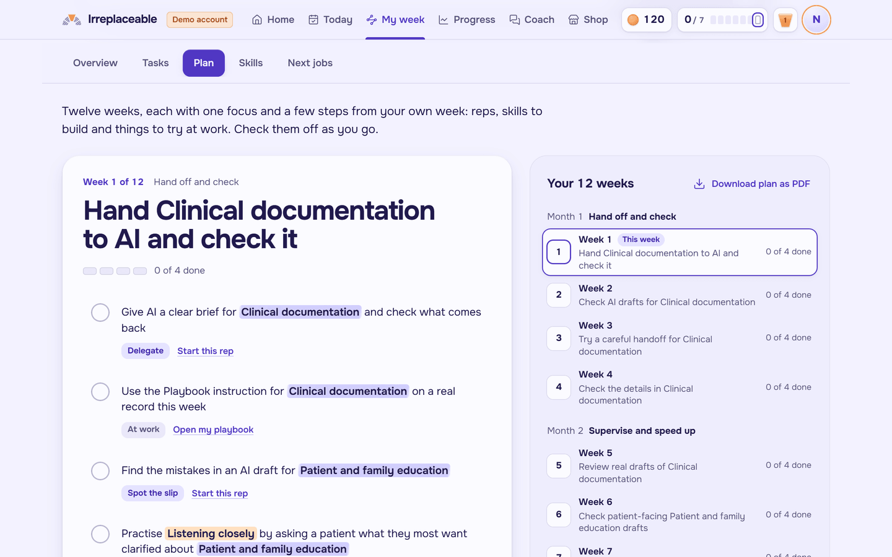
</p>
<sub>Week 1 of a nurse's 12-week plan, with the list of all twelve weeks on the right.</sub>

### Skills from your resume

- The model reads your resume, or a few lines about your work, and picks out the skills you already use, matched to O\*NET skills and backed by short quotes from your text.
- Code keeps a skill only when its quote is really in the text. You confirm or remove each one and add your own.
- The gaps worth closing, for your job and for the jobs near it, feed straight into the plan. Only the skills and the short quotes are kept, never the whole text.

### Next jobs

Jobs close to yours by skill and knowledge profile where more of the week stays human, with the pay difference and the skills you would need to add. Open any of them to see your own week moved into that job: which of your tasks carry over and what would be new.

### A personal AI coach with voice

The Max coach reads your week map, reps, skills, progress and your 90-day plan with its checks before every answer, and points you to the next step on a real screen of the product.

- Suggested questions come from your own week, for example what to focus on this week in your plan.
- You can type or record a voice message of up to 60 seconds; the audio is transcribed in memory and never stored.
- Answers stream as they are written. The coach is told to say plainly when something is not in your records instead of inventing it.

<p>
  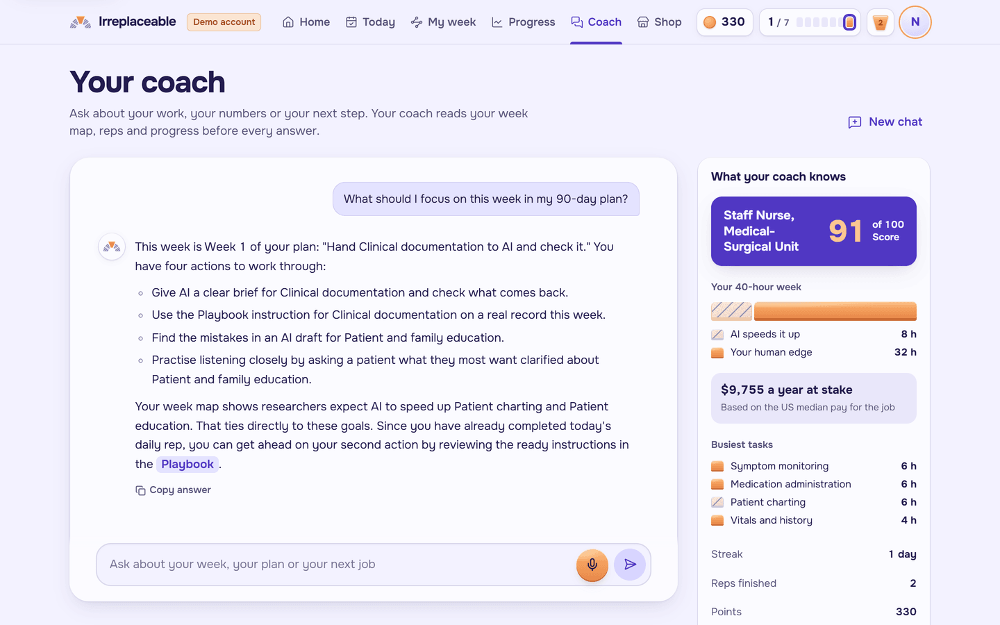
</p>
<sub>The coach answers from the nurse's own plan and week; the side panel shows everything it reads.</sub>

### Points and the shop

Everything useful earns points, and the points buy real things: 250 points take 10% off Pro, and 60,000 points pay for a full year of it.

<p>
  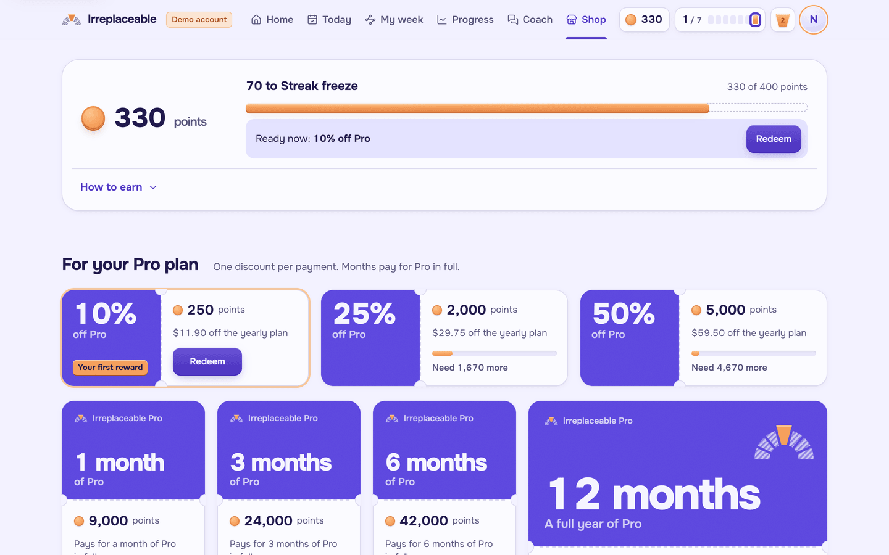
</p>
<sub>The shop: discounts and free months of Pro are real Stripe promotion codes.</sub>

<details>
<summary><b>Full points table: what earns points and what they buy</b></summary>

| You earn | Points |
|---|---|
| A week map, for up to three different jobs | 100 each |
| Your first rep ever | 50 |
| A daily rep | 20 to 60, by score, plus 20 for a perfect one |
| A round of AI or me? | 10 to 35 |
| A checked plan action | 15 |
| Streak marks at 3, 7, 14, 30, 60 and 100 days | 50 up to 3,000 |
| A colleague who maps their week from your link | 300 (they start with 100) |

| You spend | Points |
|---|---|
| 10% off Pro | 250 |
| 25% or 50% off Pro | 2,000 or 5,000 |
| 1, 3, 6 or 12 free months of Pro | 9,000 to 60,000 |
| A streak freeze | 400 |
| A month of Claude Pro or ChatGPT Plus (pilot reward, the code arrives by email) | 25,000 |

Discounts and free months are real Stripe promotion codes that apply in checkout. More partner rewards are planned, and points keep their value until then.

</details>

**XP, levels and a weekly leaderboard.** Every award also adds XP, which is never spent. Twelve levels run from "Getting started" to "Irreplaceable"; a month of daily practice reaches about level 6. The weekly leaderboard ranks XP earned since Monday. It shows only real people, each as their job and a number unless they choose a nickname, and nothing on it is seeded.

### Proof and the Review kit

Every finished rep lands in **Progress** with its date and score, and your score on the map moves only with this verified practice.

- **Proof page (Pro):** make any rep public on a page that shows your job, your score and those reps, and never your name, pay or resume.
- **Review kit (Max):** a one-page brief for a talk with your manager: what you now do with AI, where your judgment matters and the reps that prove it. The model writes it from your own records, and code drops any line whose number is not in your facts or whose task is not one of yours.

<p>
  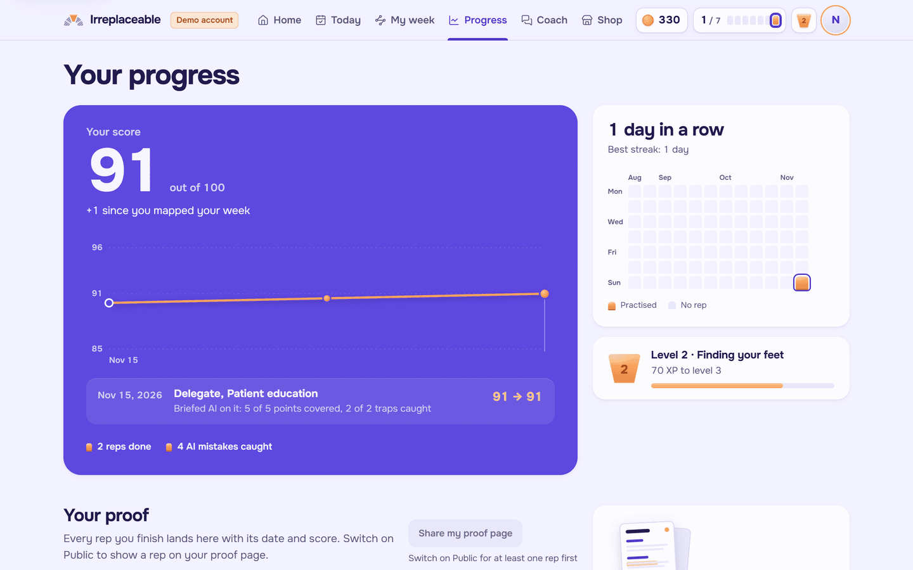
  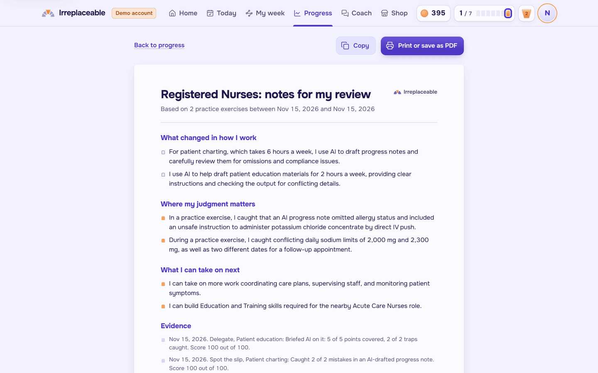
</p>
<sub>Left: Progress with the score history, streak and level. Right: the Review kit written from the same two reps.</sub>

### Playbook, Second look and job pages

| Feature | What it does | Plan |
|---|---|---|
| **Playbook** | Ready instructions for the tasks in your week that AI already helps with. You copy one into ChatGPT, Claude or Copilot, then check what comes back against the short checklist under it. | Max |
| **Second look** | Paste something an AI wrote for your work and get up to six places a careful specialist in your job would check before using it. The text is never stored, cached or logged. | Max |
| **Public job pages** | A page for each of the 923 jobs in the data, built from the same numbers, so anyone who searches "will AI replace my job" lands on a real breakdown and can map their own week from there. | Free |

### On a phone

<p>
  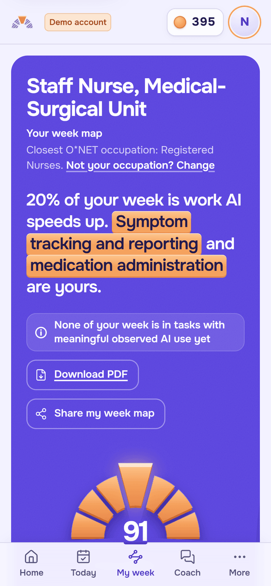
  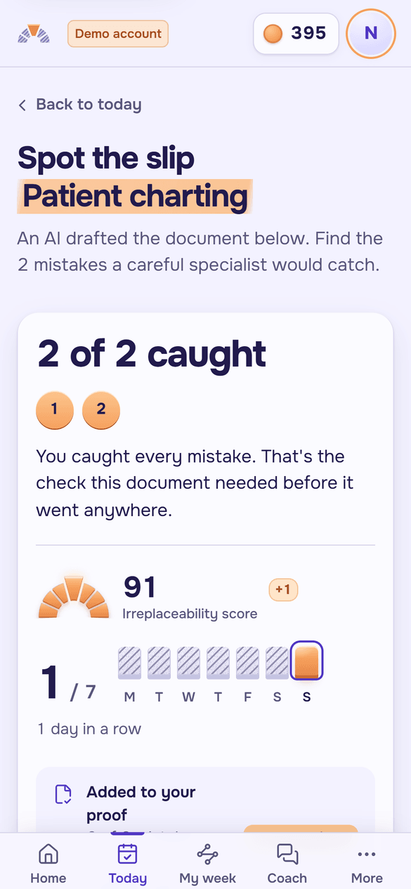
  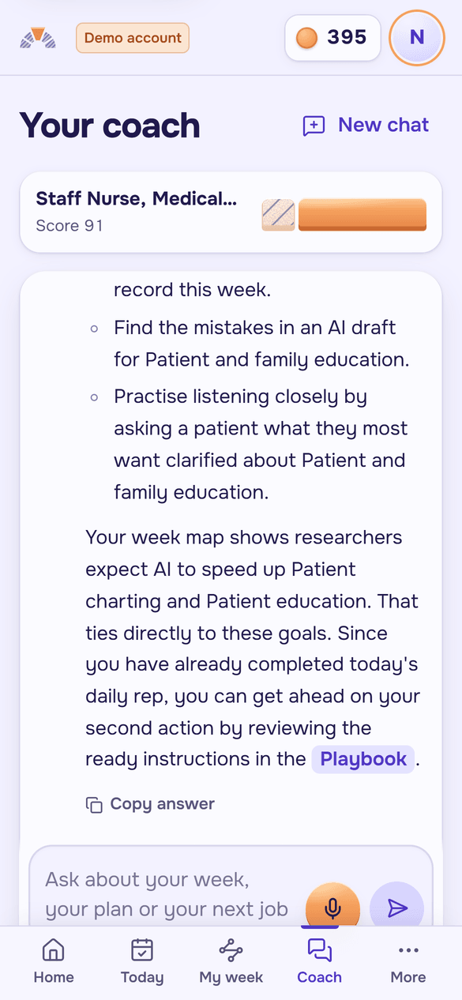
</p>
<sub>The week map, a Spot the slip result and the coach at 390 px wide.</sub>

## Plans

The week map is free; people pay for daily practice on their own work, and Max adds the coach and the tools for real work and reviews.

| Plan | Price | What's included |
|---|---|---|
| **Free** | $0 | Week map with a PDF report, AI or me? every day, one live trial rep, public job pages |
| **Pro** | $19 a month, or $119 a year ($9.92 a month) | Daily reps of all three kinds plus extra practice, the detailed 12-week plan, skills from your resume, all next jobs, the proof portfolio, points and the shop, streak and levels |
| **Max** | $79 a month, or $479 a year ($39.92 a month) | Everything in Pro, plus the personal AI career coach with chat and voice, Playbook, Second look and the Review kit |

- Both paid plans start with a 7-day free trial on the first subscription, and paying yearly saves up to 49%.
- A subscription is managed and cancelled in the Stripe Billing Portal from your profile. Points-shop codes apply in checkout.
- Until November 30, 2026, Max is free through the Business Cup 2.0 offer at `/cup`.

<p>
  
</p>
<sub>The pricing page on the yearly toggle, with the three plans and what each one includes.</sub>

### Why people pay, and why they renew

People pay because the stake is their own pay: in the occupations where AI already reaches a third of the week, the pay at stake averages $26,500 a year per worker. The free map shows that number for their own week; Pro gives them a structured way to keep it. They renew because what they build stays with them and grows.

<details>
<summary><b>The renewal mechanics and the evidence behind them</b></summary>

| What keeps them | Evidence | How it drives renewal |
|---|---|---|
| Daily ten-minute reps and a streak | Duolingo learners with a 7-day streak are 3.6 times more likely to finish a course ([Duolingo](https://blog.duolingo.com/how-duolingo-streak-builds-habit/), correlational). Habits take a median of 66 days to form ([Lally et al., 2010](https://doi.org/10.1002/ejsp.674)). | A 7-day trial cannot build the habit, so we lead with the yearly plan, which covers that window. |
| Practice with graded feedback | Testing beats re-reading for retention ([Roediger and Karpicke, 2006](https://doi.org/10.1111/j.1467-9280.2006.01693.x)) | The score rises visibly, and that progress is what people renew. |
| Points that turn into discounts and free months | Gamification meta-analysis: g = 0.49 cognitive, 0.36 motivational, 0.25 behavioural ([Sailer and Homner, 2020](https://doi.org/10.1007/s10648-019-09498-w)) | Points earned before the renewal date become a discount on it. |
| Proof page and Review kit | People value what they built themselves ([Norton, Mochon and Ariely, 2012](https://doi.org/10.1016/j.jcps.2011.08.002)) | Leaving means losing the portfolio, and the yearly review cycle gives a reason to stay (assumption). |
| Trial plus yearly plan | In Education apps, trial users earn 50.4% more 12-month LTV than direct buyers, and yearly plans keep 19.9% at day 380 against 14.2% for monthly ([Adapty 2026](https://adapty.io/blog/education-app-subscription-benchmarks/)) | We lead with the trial and the yearly price. |

We take one risk seriously: RevenueCat reports that monthly plans of AI apps retain 36% worse than other apps ([RevenueCat 2026](https://www.revenuecat.com/state-of-subscription-apps-2026/)). That is why we sell progress and proof, and the chat is only one part of the top plan.

</details>

## What you can't get by asking ChatGPT

The model is the engine that reads resumes, writes reps and plans, grades open answers and talks in the coach; the product is everything around it, and none of that comes from a chat window.

| What a chat with a model can't give | What Irreplaceable does |
|---|---|
| A path to a result | Week map, then daily reps, then a 12-week plan you check off, then a Review kit for the raise conversation |
| Memory of your progress | Rep history, a proof page, plan check-offs and a score that moves only with verified practice |
| Personalisation that grows over time | Reps drawn from your week's tasks; skills from your resume feed the plan; Second look on real drafts from your work; next jobs from your skill profile |
| Reasons to come back | Streak, the daily AI or me? game, XP and a weekly leaderboard, points that become discounts and free months |
| Answers you can trust | Spot the slip is graded by code; every generated document must pass code checks and an independent review; every number on the map comes from public data with its source |
| A data asset | O\*NET tasks joined task by task to Anthropic Economic Index usage and GPTs-are-GPTs research labels, checked against two published measures |

## The business

The product has no users yet, so every conversion, renewal and cost figure below is a named public benchmark at its median or is marked as an **assumption**; the financial model uses Pro prices alone, so Max revenue is not counted.

| Measure | Value | Basis |
|---|---|---|
| Serviceable market (SAM) | 27.3M employed adults aged 25 to 44, $3.2B a year at $119 | Our pipeline with BLS data |
| Paying subscribers for $100M ARR | 679K, 2.5% of the SAM | ARR per subscriber $147 (assumption on plan mix) |
| New payers needed | About 62K a month from 2.32M free maps | RevenueCat medians: 7.1% start a trial, 37.4% of trials pay |
| Lifetime value | $116 | ARPU $12.27 × 86% gross margin ÷ 9.1% monthly churn |
| Blended acquisition cost | $32 | 60% organic at $15, 25% paid social at $80, 15% employer-paid at $20 (shares are assumptions) |
| LTV/CAC and payback | 3.6, about month 4 | Paid social alone gives 1.45; the model needs at least half organic |

<details>
<summary><b>Market sizing: from 91.9M adults to the 5-year target</b></summary>

| Layer | People | Value at $119 a year | Source |
|---|---|---|---|
| US adults 25 to 44 | 91.9M | | [Census Vintage 2025](https://www.census.gov/newsroom/press-releases/2026/vintage-2025-pop-estimates.html) |
| Employed, 25 to 44 | 73.3M | | [BLS CPS 2025, Table 11b](https://www.bls.gov/cps/cpsaat11b.htm) |
| **TAM:** employed 25 to 44 in the occupations we map | 68.1M | $8.1B | our pipeline with CPS and [BLS OEWS May 2025](https://www.bls.gov/oes/current/oes_nat.htm) |
| **SAM:** of those, in occupations where AI does or speeds up at least a third of the week | 27.3M | $3.2B | our pipeline |
| SAM core: the same group in O\*NET job zones 3 to 5 (medium to extensive preparation) | 17.1M | $2.0B | our pipeline |
| **SOM:** 5-year target (assumption) | 679K paying | $100M ARR | below |

The target is 2.5% of the SAM and 4.0% of its core. For scale, Duolingo had 12.2M paid subscribers in Q4 2025 ([Duolingo shareholder letter](https://investors.duolingo.com/static-files/961ce633-3cee-49d0-bd7a-2c63731d45fb)).

</details>

<details>
<summary><b>The path to $100M ARR: the funnel</b></summary>

We assume half of new payers choose the yearly plan (**assumption**; RevenueCat sees 34% yearly and 42% monthly across all apps, and our web checkout leads with the yearly price). Because yearly subscribers stay longer, the standing base ends up about 74% yearly, and ARR per subscriber is $147. **$100M ARR therefore needs 679K paying subscribers**, sustained by about 62K new payers a month.

| Funnel step, steady state | Per month | Rate used | Benchmark |
|---|---|---|---|
| Free week maps | 2.32M | | |
| Trial starts | 165K | 7.1% | [RevenueCat 2026](https://www.revenuecat.com/state-of-subscription-apps-2026/), North America download-to-trial median (top quartile above 15%) |
| Paid | 62K | 37.4% | RevenueCat 2026, trial-to-paid median for 5 to 9 day trials (top quartile 47.9%) |
| Map to paid, overall | | 2.66% | Cross-check: [Adapty web quiz funnels](https://adapty.io/blog/what-is-web-to-app-and-how-does-it-work/), quiz to paywall 70 to 85% times paywall to purchase 2 to 5%, about 1.4 to 4.3% |

This is the hardest number in the plan: about 28M free maps a year at median rates, or 10.3M at top-quartile rates. The 923 public job pages are there to catch "will AI replace my job" searches from all 155M US workers, and the shareable week map brings in more.

</details>

<details>
<summary><b>Unit economics, built around renewals</b></summary>

| Renewal input | Value | Source |
|---|---|---|
| Monthly plan, first renewal | 56% (P25 48%, P75 66%) | [RevenueCat, Education median](https://www.revenuecat.com/state-of-subscription-apps-2026-education) |
| Monthly plan, retained at month 6 and month 12 | 34% and 16% | Derived: first renewal 56%, then fitted to 14.2% retained at day 380 ([Adapty 2026](https://adapty.io/blog/education-app-subscription-benchmarks/)) |
| Yearly plan, first renewal | 24% (P25 17%, P75 32%) | RevenueCat, Education median |
| Yearly plan, later renewals | 50% | **Assumption** |

**Cost to serve one paying user per month.** About 143 model calls (**assumption**: 30 daily reps with their grading, 13 extra reps with grading, 4 human-edge conversations of 12 turns, 4 Second looks and 5 plan or Review kit calls) at our measured $0.001 to $0.005 per call, which comes to **$0.43**. Hosting is $0.25 (**assumption**). Points-shop free months and partner rewards are capped at 5% of revenue (**assumption**). Stripe charges 2.9% plus 30¢ per payment ([Stripe pricing](https://stripe.com/pricing)), and web checkout avoids the 15 to 30% app-store fee.

| Per new payer, 36-month horizon | Monthly plan | Yearly plan |
|---|---|---|
| Paid periods | 5.7 months | 1.36 years |
| Revenue | $108.6 | $161.8 |
| Payment fees, AI and hosting, rewards | $4.9, $3.9, $5.4 | $5.1, $11.1, $8.1 |
| Gross profit (margin) | $94.4 (87%) | $137.6 (85%) |

**LTV = ARPU × gross margin ÷ monthly churn = $12.27 × 86% ÷ 9.1% ≈ $116.** The 9.1% is the blended churn implied by an average paid life of 11 months.

| Channel | Cost per paying user | Share of new payers | Basis |
|---|---|---|---|
| Organic: 923 job pages and the shareable week map | $15 | 60% | **Assumption**: content upkeep and serving. The map itself is computed from data, with no model call. |
| Paid social | $80 | 25% | [Adapty Meta Ads Q3 2026](https://adapty.io/meta-ads-benchmarks/): median $64.93 per paying user; the US uplift is an **assumption** |
| Employer reimbursement | $20 | 15% | **Assumption** for an HR pack and invoicing. Budgets exist: $846 direct learning spend per employee in 2025 ([ATD 2026](https://www.td.org/content/atd-blog/highlights-from-atd-s-2026-state-of-the-industry-report)), and up to $5,250 a year is tax-free under [IRS §127](https://www.irs.gov/newsroom/frequently-asked-questions-about-educational-assistance-programs) |

**Result.** Blended CAC is $32, so **LTV/CAC is 3.6** and payback comes around month 4; Adapty calls about 3 to 1 a good ratio ([Adapty unit economics guide](https://adapty.io/blog/unit-economics-subscription-app-and-how-to-calculate-it/)).

**Sensitivity.** If paid social grows to half of new payers, LTV/CAC falls to 2.4. Paid social alone gives 1.45, with payback at 7.6 months. Renewals at the P25 level give 3.4, and a model cost of $0.005 per call gives 3.5. The real condition is simple: **LTV/CAC stays at 3 or above only while at least half of new payers come organically**, which is why the job pages and the share card exist from day one.

</details>

<details>
<summary><b>Why $119 a year, and what we measure first</b></summary>

| Product | US price |
|---|---|
| LinkedIn Premium Career | $39.99 a month or $239.88 a year |
| Coursera Plus | $35 a month or $239 a year |
| Grammarly Pro | $30 a month or $144 a year |
| ChatGPT Plus | $20 a month |
| Blinkist Premium | $99.99 a year |
| Headspace | $12.99 a month or $69.99 a year |

$119 sits below the career tools tied to income, such as LinkedIn Premium and Coursera Plus at about $240, and above habit apps like Headspace, because the stake is the user's pay. It is half a year of ChatGPT Plus and 14% of an average employer's learning spend per employee, small enough to approve without procurement. The $19 monthly price makes the yearly plan a 48% saving, close to LinkedIn's annual discount. We have not yet tested willingness to pay with real users. Prices are from the products' own pages or third-party price trackers, checked in 2026.

**What we measure first.** In the first 90 days we measure map to trial, trial to paid and the first monthly renewal against the medians above, and we spend on paid acquisition only after the first renewal reaches 56%. Auto-renewal stays fair: a reminder before every yearly charge, cancellation in one click, and checkout on the web, so there are no app-store refund queues.

</details>

## Roadmap

Everything here is a target for the next twelve months.

| When | What |
|---|---|
| Quarter 1 | US launch. All 923 job pages indexed. Measure map to trial, trial to paid and first monthly renewal, with first renewal at 56% or more as the gate for paid acquisition. |
| Quarter 2 | Employer reimbursement pack: invoice, an HR one-pager and a §127 note. Pilots with employers through users who ask for it. |
| Quarter 3 | Next English-speaking markets (UK, Canada, Australia), which need local wage data. A wider occupation classifier (ESCO or ISCO) for jobs outside O\*NET. |
| Quarter 4 | Partner rewards, where AI-tool vendors fund shop items instead of us buying them at retail. Employer-paid plans for teams. The first reading of yearly renewals at month 12. |

## Data and method

Every number on the week map comes from public data through code, and the model never invents a category, a share of AI use or a wage.

<p align="center">
  
</p>
<sub>Five public sources are joined in code into one bundle per occupation; the week map is computed from those bundles in the browser.</sub>

| Source | Version | What it gives us | License |
|---|---|---|---|
| [O\*NET Database](https://www.onetcenter.org/database.html) | 31.0, August 2026 release | Occupations, 18,838 task statements with importance and frequency, 53,323 job titles, skills, knowledge and related occupations | CC BY 4.0 |
| [Anthropic Economic Index](https://huggingface.co/datasets/Anthropic/EconomicIndex) | Release 2026-06-26 (April and May 2026 data), plus earlier releases for history | Observed AI use per O\*NET task: share of conversations, automation versus collaboration, share of work use | CC BY |
| [GPTs are GPTs](https://github.com/openai/GPTs-are-GPTs) (Eloundou et al., [Science 2024](https://doi.org/10.1126/science.adj0998)) | `full_labelset.tsv` | Research labels per task: can an LLM alone (E1), with tools (E2) or not (E0) cut the time in half | MIT |
| [BLS OEWS](https://www.bls.gov/oes/current/oes_nat.htm) | May 2025, national | Median wage and employment per occupation | Public domain |
| [Microsoft Working with AI](https://github.com/microsoft/working-with-ai) | v1.1 | Physical-task flag per task, and a validation measure | CC BY 4.0 |

**Validation.** Averaged to whole occupations, our indicator agrees with Anthropic's published observed exposure at Spearman ρ = 0.64 across 756 occupations, and with Microsoft's AI applicability score at ρ = 0.66 across 773 occupations. The full method, with every threshold, is on the [How we measure](https://irreplaceable-gamma.vercel.app/method) page.

<details>
<summary><b>How a task gets its group, and the formulas behind every number</b></summary>

**How a task gets its group.**

- **AI already does it:** the Economic Index shows the task in real work use (at least half of its use is work, with a measurable share of conversations), and most of that use is automation (70% or more on Claude.ai). Automation seen only through the API counts only when the research labels also rate the task highly.
- **AI speeds it up:** observed work use that is mostly collaboration, or no observed use but strong research labels (at least one rater gives E1 and none gives less than E2). A task rated E2 counts here only when rare real use backs it up and it is neither hands-on nor people work.
- **Stays yours:** everything else, including hands-on work and work with people that researchers rate low.

Each task is labelled on screen as **observed** or **research estimate**. Only 6.5% of tasks pass the observed-work gate today, so most labels are estimates, and the map says so. Across the data, 370 tasks fall into AI already does it, 4,659 into AI speeds it up and 13,809 into Stays yours.

**How the week and the numbers are computed.**

- **The typical week** without a resume: each task gets weight = importance × relevance ÷ 100 × √(times a year), and the top ten tasks share 100% of the week, each between 3% and 25%. With a resume, the model proposes the shares from your duties; code keeps only real tasks of your occupation, normalises them to whole percentages that add up to 100 across 4 to 14 tasks, and you can move every slider.
- **Pay at stake** = your yearly pay (the BLS median for your occupation, or the salary you enter) × (AI already does % × 1 + AI speeds it up % × 0.5) ÷ 100.
- **Irreplaceability score**: base = round(100 − (AI already does % + 0.5 × AI speeds it up %)), then score = base + (100 − base) × 0.45 × F, where F = (1 − e^(−n ÷ 8)) × your average rep score and n is the number of completed reps. Practice can win back at most 45% of the gap, and the first reps count most. The score is not a probability of anything.
- **Next jobs**: cosine similarity of centred skill and knowledge importance (at least 0.86, or 0.7 for O\*NET related occupations), preferring jobs where more of the typical week stays human, with the BLS pay difference and the skills you would need to add.

**Caveats.** The Economic Index only sees Claude usage, and a task missing from it means "not observed above the publication threshold", not zero. Wages are US medians. The 25 to 44 market figures use CPS age shares by major occupation group.

**Rebuilding the data.** `npm run data:build` downloads the sources it can into `data/raw/`, joins them and writes `data/build/*.json` plus one bundle per occupation in `public/data/occ/`, with a SHA-256 manifest. The BLS site refuses scripted downloads, so the file `oesm25nat.zip` has to be downloaded once in a browser and saved to `data/raw/bls_oews_may2025_nat/`. The built data is in the repository, so running the app does not need this step.

</details>

**Attribution.** This product includes information from the O\*NET 31.0 Database by the U.S. Department of Labor, Employment and Training Administration (USDOL/ETA). Used under the CC BY 4.0 license. Irreplaceable has modified all or some of this information. USDOL/ETA has not approved, endorsed, or tested these modifications. O\*NET® is a trademark of USDOL/ETA. AI usage data: Anthropic Economic Index (CC BY). Task exposure labels: Eloundou, Manning, Mishkin and Rock, "GPTs are GPTs", Science 2024 (data MIT). Physical-task flag: Tomlinson et al., "Working with AI" (CC BY 4.0). Wages: U.S. Bureau of Labor Statistics, Occupational Employment and Wage Statistics, May 2025.

## How it is built

The browser renders the product and computes the map; a Next.js server on Vercel owns the reps, plan, coach, billing and points; Redis, OpenRouter and Stripe sit behind it.

<p align="center">
  
</p>
<sub>Three layers: the browser, the Next.js server and the external services. Dashed boxes are services and data files outside our code.</sub>

| Part | Choice |
|---|---|
| App | Next.js 16.4 (App Router, route handlers) with React 19.3 and TypeScript, hosted on Vercel |
| Storage | Upstash Redis for profiles, week maps, reps, plans, budget counters and the leaderboard |
| AI | OpenRouter: Gemini 3.8 Flash (`google/gemini-3.8-flash`) and GPT-6 Luna (`openai/gpt-6-luna`), each the failover of the other |
| Payments | Stripe Checkout, Billing Portal and promotion codes, test mode only |
| Accounts | Email and password with Node's scrypt, on top of anonymous profiles |
| Validation | zod 4 for every request and every model answer |
| Search | MiniSearch over the O\*NET title index |
| Resume PDF | unpdf, in the browser |

**What the model does and what code does.** The model reads resumes, picks the occupation from candidates that code found, proposes week shares, writes reps, plans, skills, Playbook instructions and Review kits, grades open answers against rubrics, plays the other person in Human edge and answers in the coach. Code does everything that must be exact: the task data, the groups, the numbers on the map, the Spot the slip grading, points, XP, streaks, the leaderboard, prices and access.

<details>
<summary><b>The AI client: schemas, budget, failover and caching</b></summary>

Every structured model call goes through one door, `src/server/ai/client.ts`. The coach's streamed answers and voice transcription use a sibling module, `src/server/coach/stream.ts`, with the same budget reservation and failover.

1. **A strict JSON schema** is generated from a zod schema, so the model has to answer in the exact shape, and the answer is validated again with zod.
2. **The budget is reserved before the call.** The worst-case cost is added to a global total and a daily counter with an atomic Redis `INCRBYFLOAT`; if either goes over `AI_BUDGET_USD` or `AI_DAILY_CAP_USD`, the call is refused, so parallel calls cannot overspend together. After the call the reservation is settled to the real billed cost.
3. **Failover.** Each model gets two attempts with backoff; then the call moves to the other model. If both fail, the person sees an honest error with a Try again button and their input is kept. No prepared content is ever served in place of a live answer, and no other job's content is ever shown.
4. **Caching** for deterministic operations only (resume reading, the Review kit for the same facts), so reopening something costs nothing.

</details>

<details>
<summary><b>How a Spot the slip rep is made and graded</b></summary>

The service picks a task from your week and the mistake types that fit your occupation group. The model writes the document and lists each planted mistake with the exact quote, its type, an explanation and a fix. Code then checks that every quote appears exactly once in the document, that no two overlap, that the types are valid and that an "omission" is a real missing step and not a missing name or ID. A second, independent model call reviews the document as a specialist would. Only a rep that passes both is stored; the browser gets the document without the answers. When you submit, code grades your highlighted ranges against the stored positions, and the points, XP, streak, proof entry and score update in the same versioned write of your profile.

**Other checks in code.** Skills are kept only when their quote is found in your resume text. Plan items must name your real tasks and skills. Review kit lines are dropped when a number is not in your facts. Delegate traps are matched by code in your instruction and your review.

</details>

<details>
<summary><b>Storage, accounts and payments</b></summary>

- **Storage** is chosen explicitly and never falls back silently: Upstash Redis when `KV_REST_API_URL` and `KV_REST_API_TOKEN` are set, private Vercel Blob when only `BLOB_READ_WRITE_TOKEN` is set, and local files in `.data/` otherwise (refused on Vercel, where files do not survive). Keys are namespaced per environment (`irr:dev:`, `irr:preview:`, `irr:prod:`), so a local run never touches production data. Profile writes are versioned, so two tabs writing at once cannot lose each other's changes.
- **Accounts.** A guest gets an anonymous profile (an id and a secret in the browser, plus a cookie) and can map a week, do the trial rep and play AI or me? without signing up. Starting a subscription or the Business Cup offer asks for an account: email and password, hashed with scrypt (N = 16384, r = 8, p = 1) and a random salt per account. Each signed-in device holds its own secret, so logging out on one device leaves the others signed in.
- **Payments** run in Stripe test mode only; a live key is refused. `npm run stripe:setup` creates the products, the four prices ($19 and $119 for Pro, $79 and $479 for Max), one coupon per shop discount and the Billing Portal configuration, and it is safe to run again. The webhook at `/api/billing/webhook` is optional; without it the same sync happens when an expired plan is read.

</details>

<details>
<summary><b>Repository map</b></summary>

| Path | What lives there |
|---|---|
| `src/app` | Pages and API route handlers: `(marketing)` for the landing, pricing, `/cup` and `/method`; `(flow)/start` for mapping a week; `(app)` for Home, Today, the week map `/x/[id]`, Progress, Coach, Shop, Playbook, Second look, next jobs, the leaderboard and the profile; `jobs/[slug]` for public job pages; `p/[slug]` for public proof pages |
| `src/domain` | Pure logic with no I/O: task groups, week shares, the map and the score, rep validation and grading, points, XP, levels and plans |
| `src/server` | Server modules: `ai`, `auth`, `billing`, `coach`, `demo`, `growth`, `leaderboard`, `playbook`, `points`, `profile`, `progress`, `reps`, `store`, `xray` |
| `src/components` | Screens and the shared design kit |
| `src/i18n` | Interface copy |
| `scripts` | Data pipeline, Stripe setup, an OpenRouter ping and a storage round trip |
| `data/build`, `public/data/occ` | Built data: the title index, related jobs and one bundle per occupation |
| `docs` | README graphics and screenshots |
| `tests` | Vitest suites |

</details>

## Run it locally

You need Node.js 20.9 or newer (developed with Node 22.13 and npm 10.9); with an empty `.env.local` the app still starts on local file storage.

```bash
git clone https://github.com/DarinaX2005X/business-cup-2.0.git
cd business-cup-2.0
npm i
cp .env.example .env.local    # then fill in the keys you have
npm run dev
```

Open http://localhost:3000.

- **Without any keys:** the title search, the week map from a job title, AI or me? and the Business Cup unlock all work, because they need no model and no payments.
- **With `OPENROUTER_API_KEY`:** everything the model writes works too (resume reading, reps, the plan, skills, the coach, the jury demo accounts). Without it those screens show an error with a Try again button.
- **With a Stripe test key:** checkout works after one run of `npm run stripe:setup`.

| Command | What it does |
|---|---|
| `npm run dev` | Development server on port 3000 |
| `npm run check` | Type check, unit tests, copy check and a production build |
| `npm test` | Unit tests only |
| `npm run test:live` | Live model tests; they read `.env.local` and spend real money, capped by `LIVE_MAX_USD` (default $0.30) |
| `npm run ai:ping` | One cheap call to confirm the OpenRouter key and model work |
| `npm run store:check` | A write, read and delete round trip against the configured store |
| `npm run stripe:setup` | Prepares the Stripe test account (products, prices, coupons, portal) |
| `npm run data:build` | Rebuilds the data bundles from the raw sources |

<details>
<summary><b>All environment variables</b></summary>

| Variable | Required | What it does |
|---|---|---|
| `OPENROUTER_API_KEY` | For AI features | OpenRouter key for every model call. Get one at openrouter.ai. |
| `OPENROUTER_MODEL` | No | Main model, default `google/gemini-3.8-flash`. |
| `AI_BUDGET_USD` | No | Cap on total model spend across environments, default 6. Calls stop with a clear message when it is reached. |
| `AI_DAILY_CAP_USD` | No | Cap on model spend per UTC day, default 2. |
| `AI_REASONING_EFFORT` | No | Reasoning level for model calls: `off`, `minimal` (default), `low`, `medium` or `high`. |
| `STRIPE_SECRET_KEY` | For checkout | Stripe test-mode secret key (`sk_test_...`). Live keys are refused. |
| `KV_REST_API_URL`, `KV_REST_API_TOKEN` | No locally, yes on Vercel | Upstash Redis REST URL and token (the names Vercel Marketplace sets; `UPSTASH_REDIS_REST_URL` and `UPSTASH_REDIS_REST_TOKEN` also work). Without them, local files are used. |
| `BLOB_READ_WRITE_TOKEN` | No | Private Vercel Blob as the store when Redis is not configured. |
| `STORE_DRIVER` | No | Forces `redis`, `blob` or `fs`, and fails if that backend is not configured. |
| `STORE_PREFIX` | No | Overrides the per-environment key namespace. |
| `IP_HASH_SALT` | No | Salt for hashing IP addresses in rate limits. Set your own in production. |
| `NEXT_PUBLIC_SITE_URL` | No | Public origin for links, Stripe return URLs and share images, default `http://localhost:3000`. |
| `DEV_FORCE_PRO` | No | `1` treats every profile as Pro in development; ignored in production. |

Optional overrides read by the code: `OPENROUTER_MODEL_GEN` moves the long writing jobs (reps, plan, skills) to another model, for example `openai/gpt-6-luna`; `OPENROUTER_MODEL_FAILOVER` changes the failover model; `STRIPE_WEBHOOK_SECRET` turns on the Stripe webhook; `COACH_STT_MODELS` sets the speech-to-text models for voice messages; `DATA_DIR` moves the local file store.

</details>

**Deploying.** The hosted product runs on Vercel, deployed with the Vercel CLI (`vercel --prod`). Connect Upstash Redis through the Vercel Marketplace, which sets `KV_REST_API_URL` and `KV_REST_API_TOKEN`; set `OPENROUTER_API_KEY`, `STRIPE_SECRET_KEY`, `NEXT_PUBLIC_SITE_URL` and the budget caps in the project settings; run `npm run stripe:setup` once against the test account. Production data is kept under the `irr:prod:` prefix automatically.

## Tests

`npm test` runs the Vitest suites in `tests/` and next to the code in `src/`, offline, with a temporary file store and a Stripe stub.

| Area | What is covered |
|---|---|
| Data and the map | The joined data bundles, task groups and their thresholds, week shares, the score and pay at stake, title search, resume handling and the proposed week |
| Reps | Document validation (quotes found exactly once, no overlaps, weak omissions rejected), Spot the slip grading, Delegate validation and trap matching, the rep service and the rule that a rep always belongs to the person's own occupation |
| Growth | Checking skill quotes against the text and checking plan items against real tasks and skills |
| Money and accounts | Sign-up, log-in and demo accounts, checkout, the Business Cup offer, shop redemption, the full payment journey and the leaderboard |
| Platform | The AI client (strict schemas, budget reservation, retries and failover), profiles and concurrent writes, the stores and the coach service |

`npm run test:live` runs real generations for several occupations and saves the outputs to `.data/live-reps` for reading by eye. One HTTP test exercises a running app (`APP_URL`, default http://localhost:3000) with two tabs writing at once, a second device and deletion.

## Honest limits

These are the limits a user or a reviewer should know about today.

- **No users yet.** The product works end to end, but every funnel, renewal and cost figure in this README is a public benchmark or a marked assumption until real people use it.
- **Payments are test mode only.** The product has no business account, so checkout takes Stripe test cards and the code refuses live keys. Claude Pro and ChatGPT Plus months in the shop are a pilot reward fulfilled by email, without a promised date.
- **US and English only.** Wages are US medians from BLS, the market numbers are American, and the interface is English.
- **The data shows how AI is used today** and makes no forecast about layoffs. The Economic Index only sees Claude usage, only 6.5% of tasks pass the observed-work gate, and the rest of the groups rest on research labels, which the map labels as estimates. This is not career advice or a guarantee of anything.
- **Jobs outside O\*NET** are matched to the closest of the 923 occupations with task data.
- **Live generation can fail.** A new rep takes a while to write and check. When both models fail or the daily spend cap is reached, the product says so and offers Try again; it never serves a prepared rep instead.
- **Resume text goes to the model.** It is processed through OpenRouter to read duties and skills, and it is not stored by us; only the extracted duties, skills and short quotes are kept.
- **The jury demo accounts are shared.** Everyone who opens the same persona sees the same map, reps and points; only the coach chat is kept per device.
